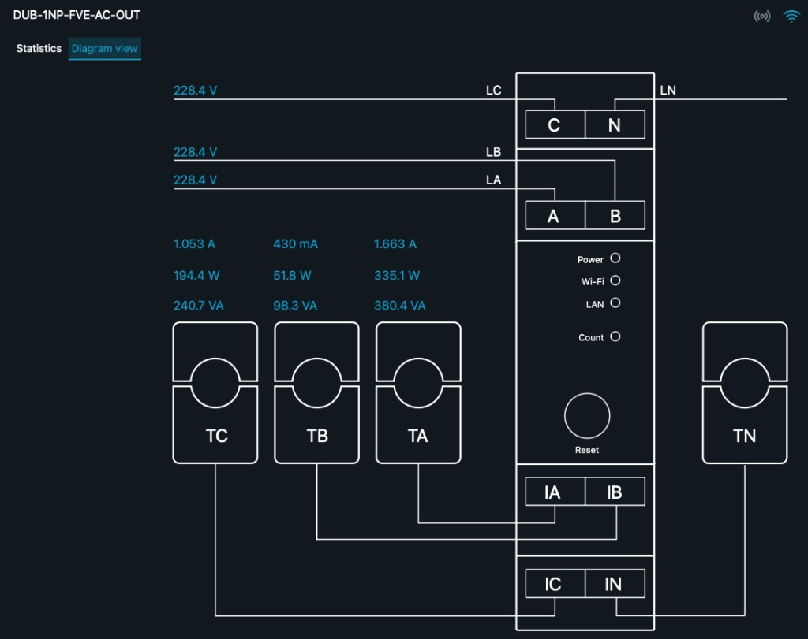

# Shelly Diagram Cards

[](https://github.com/hacs/integration)
[](https://github.com/elvisek2020/fve-shelly-card/releases)
[](https://github.com/elvisek2020/fve-shelly-card/actions/workflows/validate.yml)
[](LICENSE)

[](https://my.home-assistant.io/redirect/hacs_repository/?owner=elvisek2020&repository=fve-shelly-card&category=plugin)

Custom Lovelace karty pro Home Assistant — diagramy zařízení Shelly ve stylu
Shelly Cloud „Diagram view“. Jeden soubor obsahuje dvě karty:

- **Shelly 3EM Diagram Card** — live diagram **Shelly Pro 3EM** (napětí, proud a výkon po fázích)
- **[Shelly Pro 1 Diagram Card](#shelly-pro-1-diagram-card)** — ovládání relé **Shelly Pro 1 / Pro 1 UL**



Shelly 3EM Diagram Card:

- Centrální blok elektroměru se svorkami C/N, A/B, IA/IB, IC/IN
- Vstupní linky LC / LB / LA s napětím (V)
- CT clampy TC / TB / TA / TN s proudem (A) a výkonem (W)
- Pulzující indikace toku úměrná proudu
- Klik na hodnotu otevře nativní HA more-info dialog
- Respektuje HA theme CSS proměnné

## Předpoklady a závislosti

| Komponenta | Integrace | Co dodává |
| --- | --- | --- |
| **Shelly Pro 3EM** | nativní [Shelly](https://www.home-assistant.io/integrations/shelly/) | napětí, proud a výkon po fázích, celkový výkon / energie |
| **Shelly Pro 1 / Pro 1 UL** | nativní [Shelly](https://www.home-assistant.io/integrations/shelly/) | relé (`switch.*`), vstupy SW1/SW2, restart, firmware |

Konkrétní entity se mapují v YAML — karta není závislá na přesných názvech.

## Instalace

### HACS (doporučeno)

1. HACS → tři tečky vpravo nahoře → **Custom repositories**
2. Vlož URL `https://github.com/elvisek2020/fve-shelly-card`, kategorie **Dashboard**
3. Nainstaluj **Shelly Diagram Cards**
4. Obnov stránku prohlížeče bez cache.

HACS nabízí aktualizace z GitHub releases.

### Ručně

1. Stáhni `shelly-3em-diagram-card.js` z posledního [release](../../releases)
2. Zkopíruj do `/config/www/`
3. Nastavení → Dashboardy → ⋮ → Zdroje → Přidat:
   URL `/local/shelly-3em-diagram-card.js?v=0.4.3`, typ **JavaScript module**
   (číslo verze zvyšuj při každé aktualizaci kvůli cache)

## Konfigurace

Kartu přidej přes výběr karet (**Shelly 3EM Diagram Card**) a nastav entity
ve vizuálním editoru (entity pickery pro fáze A/B/C + volitelné součty).

Ekvivalentní YAML:

```yaml
type: custom:shelly-3em-diagram-card
title: DUB-1NP-FVE-AC-OUT
phase_a:
  name: FVE výstup
  voltage: sensor.dub_1nb_grid_ac_in_phase_a_napeti
  current: sensor.dub_1nb_grid_ac_in_phase_a_proud
  power: sensor.1np_vstupni_chodba_dub_1nb_grid_ac_in_phase_a_vykon
phase_b:
  name: Bojler
  voltage: sensor.dub_1nb_grid_ac_in_phase_b_napeti
  current: sensor.dub_1nb_grid_ac_in_phase_b_proud
  power: sensor.1np_vstupni_chodba_dub_1nb_grid_ac_in_phase_b_vykon
phase_c:
  voltage: sensor.dub_1nb_grid_ac_in_phase_c_napeti
  current: sensor.dub_1nb_grid_ac_in_phase_c_proud
  power: sensor.1np_vstupni_chodba_dub_1nb_grid_ac_in_phase_c_vykon
total_power: sensor.1np_vstupni_chodba_dub_1nb_grid_ac_in_vykon
total_energy: sensor.1np_vstupni_chodba_dub_1nb_grid_ac_in_energie
# Wi-Fi vs LAN — LED podle typu připojení; entita přidá hodnotu při najetí myší:
connection: wifi
wifi_signal: sensor.dub_1nb_grid_ac_in_rssi
reset_button: button.dub_1nb_grid_ac_in_restart
```

### Položky konfigurace

| Klíč | Povinné | Popis |
| --- | --- | --- |
| `title` | ne | Titulek v headeru |
| `phase_a` / `phase_b` / `phase_c` | ano* | Objekty s volitelným `name` + `voltage`, `current`, `power` |
| `total_power` | ne | Celkový výkon — vpravo nahoře |
| `total_energy` | ne | Celková energie — vpravo nahoře pod výkonem |
| `neutral_current` | ne | Proud neutrálu — bez něj se CT clamp **TN** nezobrazí |
| `connection` | ne | `wifi` / `lan` — jak je Shelly připojené; příslušná LED svítí i bez entity (pro LAN integrace Shelly entitu nemá) |
| `wifi_signal` | ne | Síla Wi-Fi (RSSI) — LED **Wi-Fi** svítí; hover = síla signálu |
| `lan_link_speed` | ne | Rychlost LAN linky — LED **LAN** svítí; hover = rychlost |
| `reset_button` | ne | Shelly `button.*` (reset/restart) — aktivuje klikací Reset s potvrzením |

\* Alespoň jedna fáze s entitami dává smysl; chybějící entity se nezobrazí.
Volitelný `name` se ukáže vedle „Napětí“ (LA/LB/LC) a nad proudem u CT (TA/TB/TC).
Vstupní linky **LA / LB / LC** jen když je u fáze vyplněné napětí (pozice zůstávají).
CT clampy **TA / TB / TC** jen když je vyplněný proud nebo výkon — dynamicky vycentrované.

**Připojení:** `connection: wifi` rozsvítí žlutou LED **Wi-Fi**, `connection: lan` zelenou LED **LAN** — i bez entity
(hover pak ukáže „připojeno“). Vyplněný `wifi_signal` / `lan_link_speed` LED také rozsvítí a při najetí myší
ukáže hodnotu (sílu signálu / rychlost). Entita síly signálu bývá u Shelly v HA ve výchozím stavu vypnutá.

## Shelly Pro 1 Diagram Card

Ovládací karta pro **Shelly Pro 1** (i UL verzi SPSW-201XE15UL) ve stejném stylu jako
3EM diagram. Pro 1 nic neměří, karta proto stojí na ovládání relé.

- Blok zařízení se svorkami L/N (napájení), SW1/SW2 (vstupy) a I/O (bezpotenciálový kontakt relé)
- Velké tlačítko **Výstup relé** — klik přepne výstup (`turn_on` / `turn_off`)
- Kontakt relé na čele zařízení se kreslí sepnutý / rozepnutý a dá se na něj také kliknout
- Při sepnutí „teče“ vodič z O k zátěži; během přepínání karta ukazuje „Zapínám… / Vypínám…“
- Volitelné potvrzení před přepnutím (`confirm: true`)
- Stav vstupů SW1/SW2, LED Power / Out / Wi-Fi / LAN, Reset (restart) s potvrzením
- V headeru teplota zařízení a upozornění na novou verzi firmwaru

Kartu přidej přes výběr karet (**Shelly Pro 1 Diagram Card**) a nastav ve vizuálním editoru.

```yaml
type: custom:shelly-pro1-diagram-card
title: DUB-0ZD-FVE-AC-IN
switch: switch.dub_0zd_fve_ac_in
name: Přívod FVE
confirm: true
input_1:
  entity: binary_sensor.dub_0zd_fve_ac_in_vstup_0
  name: Tlačítko
input_2:
  entity: binary_sensor.dub_0zd_fve_ac_in_vstup_1
firmware_update: update.dub_0zd_fve_ac_in_firmware
reset_button: button.dub_0zd_fve_ac_in_restartovat
connection: wifi
# volitelné (v HA jsou tyto entity Shelly ve výchozím stavu vypnuté):
temperature: sensor.dub_0zd_fve_ac_in_teplota
wifi_signal: sensor.0np_zahradni_domek_shellypro1_f8b3b7f92b48_sila_signalu
```

| Klíč | Povinné | Popis |
| --- | --- | --- |
| `switch` | ano | Výstup relé (`switch.*`, případně `light.*` / `input_boolean.*`) |
| `title` | ne | Titulek v headeru — výchozí je název entity výstupu |
| `name` | ne | Název zátěže na výstupu O (např. „Čerpadlo“) |
| `confirm` | ne | `true` = před zapnutím i vypnutím potvrzovací dialog |
| `input_1` / `input_2` | ne | Vstup SW1 / SW2 — objekt s `entity` (`binary_sensor.*`) a volitelným `name`; bez entity se vstup nezobrazí |
| `temperature` | ne | Teplota zařízení — vpravo nahoře |
| `firmware_update` | ne | `update.*` — při dostupné aktualizaci se vpravo nahoře ukáže „Firmware: Aktualizace“ |
| `connection` | ne | `wifi` / `lan` — jak je Shelly připojené; příslušná LED svítí i bez entity (pro LAN integrace Shelly entitu nemá) |
| `wifi_signal` | ne | Síla Wi-Fi (RSSI) — LED **Wi-Fi** svítí; hover = síla signálu |
| `lan_link_speed` | ne | Rychlost LAN linky — LED **LAN** svítí; hover = rychlost |
| `reset_button` | ne | Shelly `button.*` (restart) — aktivuje klikací Reset s potvrzením |

## Vývoj

```bash
npm install
npm run typecheck
npm run build      # → dist/shelly-3em-diagram-card.js
npm run watch
```

Stack: Lit 3 + TypeScript + Rollup (stejný jako [fve-flow-card](https://github.com/elvisek2020/fve-flow-card)).

## Vydání verze

1. Zvedni `version` v `package.json` (SemVer) — jediný zdroj verze, Rollup ji vloží do bundlu.
   V README uprav `?v=` u ruční instalace.
2. Doplň nahoru do `CHANGELOG.md` sekci `## vX.Y.Z — RRRR-MM-DD`; z ní vznikne text
   vydání, který HA / HACS ukazuje v okně aktualizace.
3. Commit `Release vX.Y.Z: krátký popis`, `git tag vX.Y.Z`, push commitu i tagu.
4. Workflow **Release** zbuildí kartu, přiloží `shelly-3em-diagram-card.js` a založí release.
   HACS nabídne aktualizaci.

## Známá omezení

- LED **Power** svítí vždy; **Count** pulsuje podle |výkonu|; **Wi-Fi** / **LAN** svítí podle `connection`
  nebo vyplněné entity. Karta skutečný stav připojení nezjišťuje — LED ukazuje nastavený typ připojení.
- Tlačítko **Reset** je aktivní jen když je v configu `reset_button` (`button.*`) —
  po kliknutí se zobrazí potvrzení a pak se volá `button.press`.
- Zdánlivý výkon (VA) se **nezobrazuje**.
- **Pro 1:** rozmístění svorek je schematické, ne přesná kopie čela zařízení. LED **Out** svítí
  podle stavu relé, **Power** podle dostupnosti entity výstupu.
- **Pro 1:** vstupy SW1/SW2 karta umí jen jako `binary_sensor` (vstup typu spínač).
  Vstup typu tlačítko má v HA entitu `event.*`, tu karta zatím nezobrazí.

## Autor

**[elvisek2020](https://github.com/elvisek2020)** — karta vznikla jako detailní pohled
na jednotlivé elektroměry Shelly Pro 3EM ve vlastní instalaci, doplněk k
[Hybrid Energy Flow Card](https://github.com/elvisek2020/fve-flow-card). Licence MIT.
